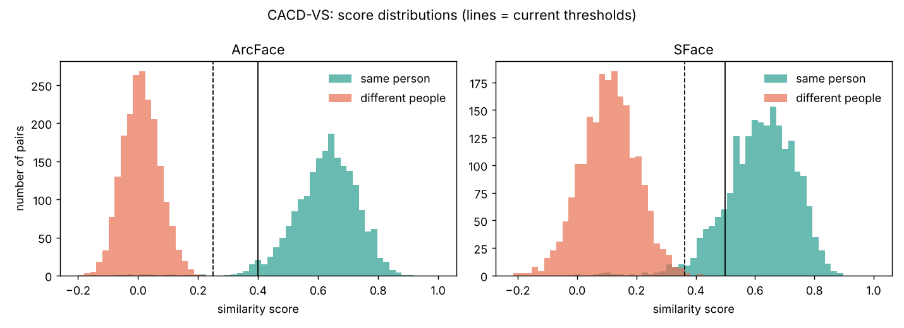

## 🖼️ Visual Match Detector
<p align="center">
  
</p>
<p align="center"><b>Part of <a href="https://github.com/4lac">❄️ R/ICE Tools</a></b> — a collection of security tools by Reyof</p>

A Python desktop tool that compares a face in an **older photo** with a face in a **recent photo** and estimates whether they belong to the same person.

### How it works
1. **Face detection** — finds faces and 5 landmarks (eyes, nose, mouth corners) using YuNet.
2. **Alignment** — uses the landmarks to straighten and crop the largest face.
3. **Face fingerprint** — two AI models turn the face into an embedding:
   - **ArcFace** (InsightFace `w600k_r50`) — the main judge
   - **SFace** (OpenCV) — shown for reference and used as a fallback
4. **Comparison** — cosine similarity between the two fingerprints.

### Verdicts
ArcFace makes the decision. The SFace score is shown for reference and is used on its own only if ArcFace is unavailable.

| ArcFace similarity | Verdict |
|---|---|
| ≥ 0.40 | 🟢 Likely the same person |
| 0.25 – 0.40 | 🟡 Possible match — needs human review |
| < 0.25 | 🔴 Likely different people |

> The tool never makes a final identification on its own. Borderline results are flagged for a human to review, because face recognition can produce false matches — especially with look-alikes, extreme angles, filters, or low-quality images.

If `onnxruntime` is not installed, the tool falls back to SFace only.

### Results on CACD-VS (cross-age benchmark)
Tested on all **4,000 pairs** of CACD-VS — 2,000 same-person pairs taken years apart and 2,000 different-person pairs.

| Model | Accuracy (10-fold) | AUC |
|---|---|---|
| **ArcFace** | **99.50%** ± 0.25 | 99.68% |
| SFace | 98.73% ± 0.51 | 99.70% |
| *Human average (reference)* | *94.6%* | |

With the app's thresholds (ArcFace):

| Truth | 🟢 match | 🟡 review | 🔴 different |
|---|---|---|---|
| Same person | 97.4% | 1.7% | 0.9% |
| Different people | **0.0%** | 0.0% | 100% |

<p align="center"></p>

**What this does and doesn't show**
- No different-person pair scored above **0.23**, so the 0.40 match threshold leaves a wide safety margin.
- CACD-VS pairs random strangers, not look-alikes. In a manual look-alike test, two different people scored **0.28** — above every stranger in the benchmark — which is why borderline scores go to human review.
- CACD-VS is made of celebrity photos, which may overlap with the data ArcFace was trained on, so real-world accuracy may be lower.
- A "second opinion" rule using SFace was tested and removed: it prevented no false matches and only sent 12 correct matches to review.

### Features
- Load two photos and see the detected face highlighted
- Similarity score with a color-coded verdict
- Handles photos with several faces (uses the largest one)
- Works with non-English file paths
- Desktop app and command-line mode

### Installation
```bash
pip install -r requirements.txt
```
The face models are downloaded automatically on first run (~330 MB in total: YuNet and SFace from the OpenCV model zoo, ArcFace from InsightFace).

### Usage
**Desktop app**
```bash
python app.py
```
**Command line**
```bash
python app.py old_photo.jpg new_photo.jpg
```

### Evaluation (Phase 2)
`evaluate.py` measures accuracy on **CACD-VS**, a cross-age face verification benchmark (2,000 same-person pairs + 2,000 different-person pairs).

```bash
python evaluate.py path/to/CACD_VS
python evaluate.py path/to/CACD_VS --limit 200   # quick trial
```
It reports 10-fold accuracy, AUC, how often each verdict appears, and recommended thresholds. Results are saved to `results/`.

> The CACD-VS images are for academic research only and are **not** included in this repository. Download them from the [official dataset page](https://bcsiriuschen.github.io/CARC/).

### Roadmap
- **Phase 1 — Two-photo comparison** ✅
- **Phase 2 — Accuracy evaluation** on CACD-VS ✅
- **Phase 3 — Video input** — compare faces from a video against a reference list, producing a ranked list for human review

### Technologies Used
- Python
- OpenCV (YuNet face detector, SFace face recognizer)
- ONNX Runtime (ArcFace face recognizer)
- Tkinter
- NumPy
- Pillow

### Model Licenses
The ArcFace model (InsightFace `buffalo_l`) is released by InsightFace for **non-commercial research use only**. YuNet and SFace are from the OpenCV model zoo.

### Responsible Use
This project is for **educational and research purposes**. Facial data is sensitive personal data — only use photos you have the right to process, and follow local data-protection laws (e.g. Saudi PDPL).
